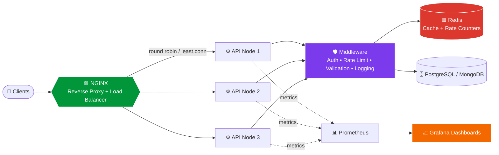

<!-- ===================== HEADER ===================== -->
<p align="center">
  
</p>

<p align="center">
  
</p>

<p align="center">
  
  <a href="https://github.com/Nitya1125?tab=followers"></a>
  
</p>

<p align="center">
  <a href="#-about-me"></a>
  <a href="#-experience"></a>
  <a href="#-tech-stack"></a>
  <a href="#-system-design--scalability"></a>
  <a href="#-featured-projects"></a>
  <a href="#-leetcode-journey"></a>
  <a href="#-connect-with-me"></a>
</p>


## 🧑‍💻 About Me

```javascript
const nitya = {
  name       : "Nitya Gandhi",
  role       : "Computer Science & Design Student",
  location   : "Gujarat, India 🇮🇳",
  education  : "B.Tech – Computer Science & Design",
  internship : "Software Development Intern @ HankersNest Technologies",
  focus      : ["Backend Engineering", "Full Stack", "REST APIs",
                "System Design", "Database Design", "DSA"],
  currently  : "Learning Redis, NGINX, Grafana & scalable architectures",
  goal       : "Secure a role at a top product-based company",
  funFact    : "I turn coffee into scalable APIs ☕ → 🔌"
};
```


## 💼 Experience

<table>
  <tr>
    <td width="60px" align="center">
      
    </td>
    <td>
      <strong>Software Development Intern — HankersNest Technologies</strong><br/>
      <sub>📍 India</sub><br/><br/>
      ✦ Built full-stack web apps with <strong>React.js, Next.js, Node.js & Express.js</strong><br/>
      ✦ Designed scalable <strong>REST APIs</strong> with authentication & CRUD<br/>
      ✦ Worked with <strong>MySQL</strong> — schema design, queries and optimization<br/>
      ✦ Debugged and optimized production-level code for performance<br/>
      ✦ Collaborated using <strong>Git & GitHub</strong> workflows
    </td>
  </tr>
</table>


## 🛠️ Tech Stack

<p align="center">
  <br/>
  <br/>
  <br/>
  <br/>
  
</p>

<p align="center">
  
  
  
  
  
  
  
  
  
</p>


## 🏗️ System Design & Scalability

> *"Make it work, make it right, make it fast — then make it scale."*

I study and build the infrastructure layer that sits **around** an API — the part that keeps it fast, safe and alive under load.

### 🔭 Reference Architecture



### 🧩 Building Blocks

<table>
  <tr>
    <td width="50%" valign="top">
      <h4>🟥 Redis — Caching & Counters</h4>
      <ul>
        <li>Cache-aside pattern with TTL-based invalidation</li>
        <li>Session & token storage</li>
        <li>Atomic counters (<code>INCR</code> + <code>EXPIRE</code>) for rate limits</li>
        <li>Cuts repeated DB reads on hot endpoints</li>
      </ul>
    </td>
    <td width="50%" valign="top">
      <h4>⏱️ Rate Limiting</h4>
      <ul>
        <li>Fixed window, sliding window & token bucket</li>
        <li>Per-IP and per-user limits backed by Redis</li>
        <li>Returns <code>429</code> with <code>Retry-After</code></li>
        <li>Protects login & public endpoints from abuse</li>
      </ul>
    </td>
  </tr>
  <tr>
    <td width="50%" valign="top">
      <h4>🟩 NGINX — Reverse Proxy</h4>
      <ul>
        <li>Single entry point in front of Node.js servers</li>
        <li>SSL termination, gzip, static file serving</li>
        <li>Upstream health checks & failover</li>
        <li>Edge-level rate limiting with <code>limit_req</code></li>
      </ul>
    </td>
    <td width="50%" valign="top">
      <h4>🧱 Middleware Pipeline</h4>
      <ul>
        <li>Express chain: logger → auth (JWT) → RBAC → validation</li>
        <li>Centralized error handling</li>
        <li>Request IDs for traceability</li>
        <li>Metrics middleware feeding Prometheus</li>
      </ul>
    </td>
  </tr>
  <tr>
    <td width="50%" valign="top">
      <h4>⚖️ Load Balancing</h4>
      <ul>
        <li>Round robin, least connections, IP hash</li>
        <li>Stateless APIs so any node can serve any request</li>
        <li>Zero-downtime rolling deploys</li>
      </ul>
    </td>
    <td width="50%" valign="top">
      <h4>📈 Grafana — Observability</h4>
      <ul>
        <li>Dashboards for latency (p50/p95/p99), RPS, error rate</li>
        <li>Cache hit ratio & DB query time panels</li>
        <li>Alerting on saturation and 5xx spikes</li>
      </ul>
    </td>
  </tr>
</table>

### ↕️ Vertical vs Horizontal Scaling

| | ⬆️ Vertical (Scale Up) | ➡️ Horizontal (Scale Out) |
|---|---|---|
| **How** | Bigger CPU / RAM on one machine | More machines behind a load balancer |
| **Complexity** | Low — no code changes | Higher — needs stateless design |
| **Limit** | Hardware ceiling | Practically unbounded |
| **Fault tolerance** | Single point of failure | Survives node failure |
| **Best for** | Databases, quick wins | Stateless APIs, web tier |
| **My approach** | Tune first, scale up the DB | Scale out the API tier, externalize state to Redis |

### 🔁 Request Lifecycle

```
Client ─▶ NGINX (TLS, limit_req) ─▶ Load Balancer ─▶ Node API
                                                        │
                      ┌─────────────────────────────────┤
                      ▼                                 ▼
           Rate Limit (Redis INCR)            Auth (JWT) + RBAC
                      │                                 │
                      └───────────────┬─────────────────┘
                                      ▼
                         Cache hit? ── yes ─▶ Return (Redis)
                              │ no
                              ▼
                        Database query ─▶ Cache set (TTL) ─▶ Response
                                      │
                                      └──▶ Metrics ─▶ Prometheus ─▶ Grafana
```


## 🚀 Featured Projects

<table>
  <tr>
    <td colspan="2" valign="top">
      <h3>🧭 Meridian — Project Management Platform</h3>
      <p><sub><code>Next.js</code> • <code>Node.js</code> • <code>Express.js</code> • <code>PostgreSQL</code> • <code>Redis</code> • <code>JWT</code></sub></p>
      <p>A full-stack project management platform for teams: workspaces, projects, task boards, assignments, role-based access and progress tracking. Built with a scalable backend — secured REST APIs, Redis caching, rate limiting and a middleware pipeline.</p>
      <p>
        
        
        
        
      </p>
    </td>
  </tr>
  <tr>
    <td width="50%" valign="top">
      <h3>🛡️ VulnScan – AI Web Vulnerability Scanner</h3>
      <p><sub><code>React.js</code> • <code>Node.js</code> • <code>Express.js</code> • <code>Python</code> • <code>MongoDB</code></sub></p>
      <p>OWASP-based web vulnerability scanner that analyzes websites for common security issues and generates detailed reports with risk scoring and remediation guidance.</p>
      <p>
        
        
        
      </p>
    </td>
    <td width="50%" valign="top">
      <h3>🏠 AI Real Estate Price Prediction</h3>
      <p><sub><code>MERN</code> • <code>Python</code> • <code>Flask</code> • <code>Machine Learning</code> • <code>MongoDB</code></sub></p>
      <p>Full-stack real estate platform with an ML model for property price prediction. Backend APIs, JWT auth, responsive UI and a Flask prediction microservice.</p>
      <p>
        
        
        
      </p>
    </td>
  </tr>
  <tr>
    <td width="50%" valign="top">
      <h3>📚 Maths Improvement ERP</h3>
      <p><sub><code>Next.js</code> • <code>Node.js</code> • <code>Express.js</code> • <code>MySQL</code> • <code>Tailwind CSS</code></sub></p>
      <p>ERP platform for school students with authentication, interactive quizzes, streak tracking, leaderboards, analytics dashboards and performance reports.</p>
      <p>
        
        
        
      </p>
    </td>
    <td width="50%" valign="top">
      <h3>⚡ Backend REST API Collection</h3>
      <p><sub><code>Node.js</code> • <code>Express.js</code> • <code>MongoDB</code> • <code>MySQL</code> • <code>PostgreSQL</code></sub></p>
      <p>Scalable REST APIs with JWT authentication, role-based access control, CRUD operations and integration across SQL and NoSQL databases.</p>
      <p>
        
        
        
      </p>
    </td>
  </tr>
  <tr>
    <td width="50%" valign="top">
      <h3>🎮 GameHub</h3>
      <p><sub><code>Flask</code> • <code>MongoDB</code></sub></p>
      <p>Gaming platform with session-based authentication, user management and a responsive game interface.</p>
      <p>
        
        
      </p>
    </td>
    <td width="50%" valign="top">
      <h3>🎬 IMDb Clone &nbsp;|&nbsp; 🌦️ Weather Dashboard</h3>
      <p><sub><code>React.js</code> • <code>TMDB API</code> • <code>Weather API</code></sub></p>
      <p><strong>IMDb Clone:</strong> movie discovery app with search, filtering and modern UI.<br/><strong>Weather Dashboard:</strong> real-time weather with live API integration.</p>
      <p>
        
        
      </p>
    </td>
  </tr>
</table>


## 🧠 LeetCode Journey

<p align="center">
  <a href="https://leetcode.com/u/Nitya_Gandhi/">
    
  </a>
</p>

<p align="center">
  
  
</p>

<p align="center">
  
  
  
  
  
  
</p>


## 📈 Current Focus

<p align="center">
  
  
  
  
  
  
  
</p>


## 📊 GitHub Statistics

<p align="center">
  
  
</p>

<p align="center">
  
</p>

<p align="center">
  
</p>

### 🐍 Contribution Snake

<p align="center">
  
</p>


## 🤝 Connect With Me

<p align="center">
  <a href="https://github.com/Nitya1125"></a>
  <a href="https://www.linkedin.com/in/nitya-gandhi-2b2032295"></a>
  <a href="https://instagram.com/nitya_1125"></a>
  <a href="mailto:nityagandhi1125@gmail.com"></a>
  <a href="https://leetcode.com/u/Nitya_Gandhi/"></a>
</p>

<p align="center">
  <i>"Code is not just logic — it's craftsmanship. Every API endpoint, every database schema, every component is a chance to build something worth being proud of."</i>
</p>

<p align="center">
  
</p>
